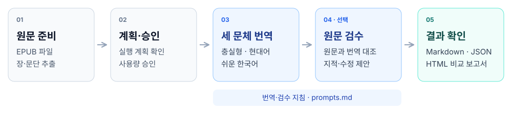

# EPUB 한국어 3종 번역

고전문학 EPUB을 챕터·문단 단위로 한국어 번역하는 Python CLI입니다. **원문 충실형·자연스러운 현대어·쉬운 한국어**를 같은 원문에서 독립적으로 생성하고 Markdown·앱용 JSON·HTML 검수 보고서를 저장합니다.

Python 3.10+와 macOS/Linux를 지원합니다. Windows는 현재 지원하지 않습니다.

## 전체 과정 한눈에 보기

원문을 준비하고 실행 계획을 확인한 뒤, 사용량 사용을 승인하면 번역을 시작합니다. 기본값은 세 문체를 모두 생성하며 `--styles`로 필요한 문체만 선택할 수 있습니다.



`--dry-run`은 AI 호출 없이 실행 계획만 확인합니다. 세 문체는 같은 원문에서 각각 번역하며, 기본 동시 작업 수는 2개입니다. 번역 기준은 `prompts.md`에서, 작품별 인물·말투·용어는 `--consistency`·`--glossary`로 지정합니다.

`--review`를 켜면 각 번역 배치 뒤에 원문 대조 검수를 추가하며, 지적과 수정 제안은 보고서에 기록합니다. **검수 결과는 번역문을 자동 수정하지 않으며, 사람이 최종 검토해야 합니다.**

같은 요청의 검증된 캐시가 있으면 새 AI 호출 대신 재사용합니다. 결과를 확인할 때는 `review_report.html`을 열어 원문과 문체별 번역을 나란히 비교하면 됩니다.

## 설치

```bash
python3 -m venv .venv
source .venv/bin/activate
pip install -r requirements.txt
```

원본 EPUB은 이용 권한을 확인해 직접 준비하세요. 프로그램은 책을 다운로드하지 않습니다. 아래 `/path/to/book.epub`을 본인 파일 경로로 바꾸면 됩니다.

## 로그인과 모델 선택

기본 방식은 ChatGPT 계정 로그인입니다. `.env`나 API 키는 필요 없습니다.

```bash
python translate_epub.py --chatgpt-login
python translate_epub.py --list-models
```

이후 명령의 `YOUR_MODEL_SLUG`는 모델 목록에 표시된 값으로 바꾸세요. 사용 가능한 모델과 계정 이용 자격은 서버에서 확인합니다. ChatGPT 사용량은 계정 한도를 따르며 무제한이 아닙니다.

## 1장 전체 번역

먼저 장 목록과 실행 계획을 확인합니다. 이 단계는 API를 호출하지 않습니다.

```bash
python translate_epub.py --input "/path/to/book.epub" --list-chapters
python translate_epub.py --input "/path/to/book.epub" \
  --model YOUR_MODEL_SLUG --chapter 1 --review --dry-run
```

계획을 확인한 후 **사용량 사용을 명시적으로 승인**해 실행합니다. 기본값으로 세 번역을 모두 생성합니다.

```bash
python translate_epub.py --input "/path/to/book.epub" \
  --model YOUR_MODEL_SLUG --chapter 1 --review --approve-plan
```

다음 장은 `--chapter 2`, 일부 문단만 시험하려면 `--sample-paragraphs 3`을 사용하세요. 같은 명령을 다시 실행하면 검증된 캐시를 재사용하며, 종료 시 챕터별·전체 소요 시간을 표시합니다.

독립된 배치 작업을 **기본 2개까지 동시에 처리**합니다. 모델·배치 크기·원문 문맥·용어집·검수 지침은 유지하고 결과는 문단 ID 순서로 저장합니다. `--workers 1`로 순차 실행할 수 있습니다. [병렬 실행 안내](docs/usage.md#동시-요청-제한)를 참고하세요.

실행 중 현재 챕터·문체·완료 배치 작업 수·경과 시간을 표시하고 macOS에서는 전체 작업의 완료·실패·중단을 알립니다. `--no-progress`, `--no-notify`로 각각 끌 수 있습니다. 추가 AI 호출은 없습니다. [진행률·알림 안내](docs/usage.md#진행률과-macos-알림)를 참고하세요.

API 키 방식은 ChatGPT 구독과 별도 과금이며 `--provider openai --approve-api`로 실행합니다. [상세 사용법](docs/usage.md)을 참고하세요. 승인 없는 실행과 `--dry-run`은 번역 요청을 보내지 않습니다.

## 번역 지침 수정

번역·검수 지침은 [epub_pipeline/prompts.md](epub_pipeline/prompts.md)에서 수정합니다. `base`는 공통 번역 원칙, `faithful`·`modern`·`easy`는 문체별 지침, `review`는 원문 대조 검수 지침입니다. `##`로 시작하는 구역 이름은 유지하고 그 아래 본문을 편집하세요. JSON 출력 스키마와 로딩 코드는 `epub_pipeline/prompts.py`에서 관리합니다.

프로그램은 시작할 때 Markdown을 읽습니다. 수정한 지침은 다음 실행부터 적용되며, 지침이 바뀐 번역·검수 요청은 기존 캐시를 재사용하지 않습니다. 작품별 인물·말투·용어 지침은 `--consistency`·`--glossary`로 전달하세요. [상세 안내](docs/usage.md#프롬프트-파일-편집)를 참고하세요.

## 결과 확인

기본 출력 위치는 `output/<EPUB 파일명>/chapter-01/`입니다.

```text
chapter-01/
  번역본/                    # faithful.md · modern.md · easy.md
  _관리/
    review_report.html       # 원문·세 번역·지적 사항 비교
    review_report.json       # 검수 결과
    aligned.json             # 문단 ID로 정렬한 앱용 데이터
    ...                      # 실행 계획·사용량·재개용 캐시 등
```

HTML 파일을 브라우저에서 열면 문체 선택, 검색, 지적 있는 문단 필터와 인쇄를 사용할 수 있습니다. 기존 결과에서도 추가 AI 호출 없이 보고서를 생성할 수 있습니다.

```bash
python translate_epub.py --review-html "output/book/chapter-01"
# macOS에서 열기: book을 실제 출력 폴더명으로 변경
open "output/book/chapter-01/_관리/review_report.html"
```

AI 검수는 문제를 보고하며 **번역문을 자동 수정하지 않습니다.** 지적이 없더라도 사람의 최종 검토가 필요합니다. 캐시·사용량 원장·스냅샷은 재개와 앱 연동에 필요하므로 임의로 삭제하지 마세요.

## 개발과 문서

Git 저장소를 clone한 뒤 커밋 전 보호를 한 번 설치하세요.

```bash
python3 scripts/install_hooks.py
```

`main`에 push하면 테스트·문법·비밀정보 검사가 자동 실행됩니다. PR 없이 사용할 수 있습니다.

| 문서 | 내용 |
|---|---|
| [상세 사용법](docs/usage.md) | 계정 관리, 전체 옵션, API 키, 검수 필드, 출력·앱 연동, 재개·사용량 |
| [개발 안내](docs/development.md) | 테스트 실행, 커밋 전 보호, GitHub Actions, 코드 구조 |

**API 키·로그인 토큰·원본 EPUB·실제 번역 결과는 Git에 올리지 마세요.** HTML 보고서에도 원문과 번역이 포함됩니다. 인증 파일은 소스·출력·공유 폴더와 분리해 보관하세요.
